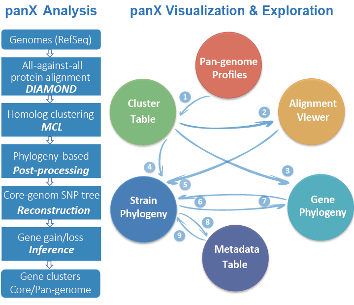

# panX: pan-genome analysis and exploration

Even closely related bacterial genomes can differ in the presence of hundreds of genes, and individual genes can be acquired horizontally from distant strains and species. This mix of inheritance patterns complicates the phylogenetic analysis of bacteria.

Several software packages analyze pan-genomes, but the visualization, interpretation, and exploration of pan-genomes remain hard. **panX** (pan-genome analysis and exploration) makes pan-genome research easier with an interactive platform to analyze and explore pan-genome data.

panX shows a pan-genome in connected views: the gene cluster table, the multiple alignment, the gene tree and the strain tree, and the strain metadata table. The analysis pipeline [pan-genome-analysis](https://github.com/neherlab/pan-genome-analysis) prepares the data: it finds the clusters of orthologous genes in large sets of genome sequences and computes the alignments, the trees, and the statistics in advance.

**panX is available at [pangenome.org](https://pangenome.org).**

## Pipeline overview



The panX analysis pipeline uses DIAMOND, MCL, and post-processing to find the clusters of orthologous genes of a collection of annotated genomes. It makes a strain tree from the SNPs of the core genome and a gene tree for each gene cluster.

The numbers in the figure mark the views of the viewer:

- (1) the pan-genome charts filter and select gene subsets in the cluster table
- a click on a gene cluster in the table loads (2) its alignment, (3) its gene tree, and (4) its gene presence, absence, gain, and loss on the strain tree
- (5) a selection of sequences in the alignment marks their strains on the strain tree
- (6, 7) the strain tree and the gene tree interact in several ways
- (8) a zoom into a clade of the strain tree filters the strains in the metadata table
- (9) a search in the metadata table shows the strains with that metadata

## Data

The viewer reads its data from a separate data host, `https://data.pangenome.org`. The data is a set of releases, each a folder of all datasets with a few files per dataset; the app finds the releases and datasets in index files, so new data needs no app rebuild.

- [docs/data-format.md](docs/data-format.md) defines the data format: the layout, the files, the HTTP behavior of the data host, and the life of a release
- `docs/schemas/` holds the JSON Schema files of the JSON files of the format
- `just verify-data` checks a data root, a local folder or a deployed data host, against the format
- the data repository [pan-genome-analysis](https://github.com/neherlab/pan-genome-analysis) builds the releases from the pipeline output in its `data-tools/`

## Development

The app is a Bun workspace with pinned tools: install them with [mise](https://mise.jdx.dev) or run every command in the development container `dev/docker/run`. With a local data root folder or the URL of a data host in `PANX_DATA`:

```bash
dev/docker/run just check
PANX_DATA=<data root> DEV_PUBLISH=8000,8001 dev/docker/run just serve
```

`just serve` builds the app and serves it on http://127.0.0.1:8000, as the deployed site serves it. [docs/development.md](docs/development.md) describes the setup, the commands, and the manual checks; [docs/deployment.md](docs/deployment.md) describes the publish of the app and the switch to the new hosts.

## License

[GNU General Public License v3.0](LICENSE)
